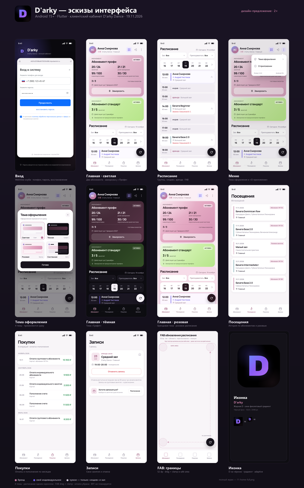

# D'arky — мобильное приложение клиента D'arky Dance

**Статус:** Foundation и Auth готовы. Вход переведён на **нативный** (D15), проверен на **AVD API 35**: тестовый клиент → home. Восстановление пароля открывает страницу клуба во внешнем браузере (D16). 32 теста, debug APK. Тестовая сессия удалена; приложение оставлено на экране входа.

| Что | Где |
|---|---|
| Код приложения | [app/](app/) · [app/README.md](app/README.md) |
| Эскизы 2×, иконка, борд | [design/README.md](design/README.md) |
| Дизайн, темы, FAB, маппинг данных, auth | [design/DESIGN.md](design/DESIGN.md) |
| WebView: скорость, вид, autofill, ограничения | [design/WEBVIEW-NOTES.md](design/WEBVIEW-NOTES.md) |
| Проверенные факты живого кабинета | [design/LIVE-FINDINGS.md](design/LIVE-FINDINGS.md) |
| Этапы, параллельная работа субагентов, промпты | [PLAN.md](PLAN.md) |
| Окружение сборки (JDK 21, Android SDK, Flutter) | [BUILD-ENV.md](BUILD-ENV.md) |
| Принятые решения | [design/APPROVAL.md](design/APPROVAL.md) |
| Документация API и авторизации | [docs/](docs/) |

## Быстрый просмотр



Борд — исторические эскизы; актуальный экран входа — нативный,
[design/mockups/01-auth.png](design/mockups/01-auth.png).

## Что предлагается

- **Flutter**, Android 15+ (minSdk 35), архитектура готова к iOS.
- **Нативный вход** (D15): телефон и пароль в Flutter-полях, `AutofillGroup`, запросы `phone_info` → `check_password` → `search`; после входа приложение забирает `client_id` и `secret`. Пароль не хранится и не логируется.
- **Восстановление пароля** (D16): ссылка открывает `/widget/2` во внешнем браузере; восстановление — модалка вендора (Telegram / MAX / звонок).
- **4 раздела:** Абонемент (профиль + расписание), Посещения, Покупки, Записи.
- **4 темы** — Светлая, Тёмная, Розовая, Системная; выбор в диалоге из меню `⋮` справа от выхода. Фон расписания следует теме.
- **Расписание без вложенного скролла:** весь день выкладывается в общий скролл экрана.
- **FAB обновления:** круглая кнопка в правом нижнем углу; перетаскивается, но всегда целиком остаётся в safe area.
- **Индивидуальные занятия (`type = 1`):** чужое — только «индив» и зал; своё — имя клиента и преподаватель (если есть).
- **Приватность:** чужие ФИО, депозиты и преподаватели не показываются и не логируются.
- **Без оплаты:** кнопка «Оплатить» убрана. «Заморозить» — full width в карточке «Профи», где она доступна; у «Стандарт» заморозки нет — пояснение. BFF не планируется.
- **HTTP (L2):** нативный клиент мимикрирует под мобильный Chrome, **версия — с телефона** (Chrome → WebView → default): UA, `Accept`, device `Accept-Language`, `Origin`/`Referer`, `Sec-Fetch-*`, low-entropy `Sec-CH-UA*`, `Priority`, `gzip/deflate/br/zstd`; cookie-less. API это не требует, но так решено.
- **Иконка:** жирная `D` сине-фиолетовым градиентом на чёрном фоне; adaptive + monochrome, 2048/1024.

## Код: Foundation + Auth

```powershell
. .\tools\env.ps1
cd app
flutter analyze   # 0 issues
flutter test      # 32 tests
flutter build apk --debug
```

Готово: 4 темы с сохранением, 4 таба, `ApiClient` с L2-профилем и Brotli/Zstd, `ChromeVersionProvider` + `<queries>`, `SessionStore`, `BranchClock`, `JsonCache`, логирование с redaction, контракты/fakes, фикстуры, иконка/adaptive/splash; Auth: нативные поля, `phone_info`/`check_password`, `widget_client_lk/search`, сессия в Keystore, переход на home. Проверено на AVD API 35 тестовым клиентом; recovery-ссылка открывает Chrome.

`compileSdk 36` (требование `flutter_secure_storage`/`shared_preferences_android`), `minSdk/targetSdk 35`; WebView из auth удалён. Все ограничения и варианты кастомизации WebView — в [design/WEBVIEW-NOTES.md](design/WEBVIEW-NOTES.md).

## Проверено на живом кабинете

У клиента **два активных абонемента**: «Профи» (20/24, 21/21 день заморозки — заморозка доступна) и «Стандарт» (3/5, без дней заморозки — недоступна). В вебе кнопка «Заморозить» одна на кабинет; в приложении она будет только в карточке, где заморозка реально есть. Подробности — [design/LIVE-FINDINGS.md §3](design/LIVE-FINDINGS.md#3-абонементы-и-заморозка-перепроверено-19112026).

## Что принято

Решения D1–D16 зафиксированы в [DESIGN.md §10](design/DESIGN.md) и [APPROVAL.md](design/APPROVAL.md).

Дизайн утверждён, Foundation и Auth проверены. Дальше — расписание, абонементы, история, записи.
