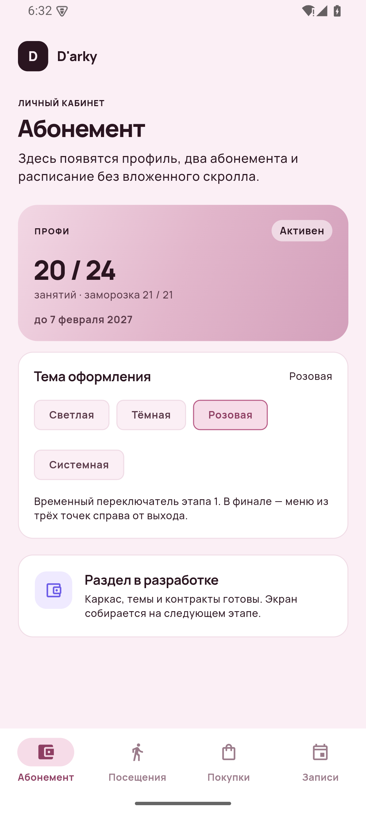
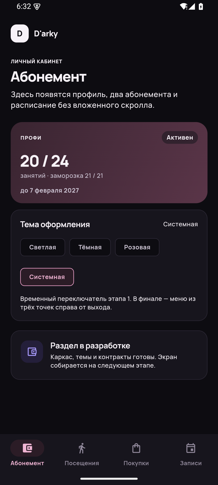

# D'arky — Flutter app

Клиент D'arky Dance для Android 15+. Foundation + Auth + MVP-разделы:
темы, каркас, сетевой профиль L2, **нативный вход** (D15),
хендофф `client_id`/`secret`, сессия в Keystore, абонементы, расписание,
посещения, покупки и записи. Проверено на AVD API 37 с живым API.

Исторические Foundation-скриншоты (до MVP-разделов):

| Светлая | Тёмная |
|---|---|
|  |  |

Нативный вход на AVD API 35: [auth-avd.png](docs/screenshots/auth-avd.png).
Живой прогон на AVD API 37: два абонемента, 20 занятий дня, 90 посещений,
9 операций, 1 запись, QR-баркод; кнопка восстановления открывает `/widget/2`
во внешнем браузере.

Все наблюдения по вендорскому WebView (скорость, VK-ветка, CSS, autofill,
ограничения) — в [design/WEBVIEW-NOTES.md](../design/WEBVIEW-NOTES.md).

## Запуск

```powershell
# из корня репозитория
. .\tools\env.ps1
cd app

flutter pub get
flutter run -d emulator-5554
```

Сборка и тесты:

```powershell
flutter analyze
flutter test      # 185 tests
flutter build apk --debug
```

APK: `app/build/app/outputs/flutter-apk/app-debug.apk`.
Релиз: `flutter build apk --release`; подпись и ключ — [RELEASE.md](../RELEASE.md).

## Что уже есть

- **2 темы** — Светлая и Тёмная «Графит»;
  `ThemeController` + `shared_preferences`; переключение сохраняется.
- **4 таба** — Абонемент, Посещения, Покупки, Записи; реальные экраны, не заглушки.
- **Абонемент/профиль** — `widget_client_lk/accounts`, карточки «Профи»/«Стандарт»,
  счётчики пакетов, срок, per-account заморозка, выход, меню `⋮`,
  диалог четырёх тем. Расписание встроено в тот же `CustomScrollView`.
- **Расписание** — `widget_schedule/list` + `stickers`/`changes`, день/неделя,
  фильтры зал/преподаватель, privacy для чужих индив/аренды, FAB обновления
  с drag/clamp и сохранением позиции.
- **Посещения** — `widget_client_lk/visits`, сортировка `visit_date desc`,
  пагинация 20, дедупликация, pull-to-refresh.
- **Покупки** — `widget_client_lk/deposits`, `type [11,12,13]`, группировка
  по месяцам, зелёные суммы, пагинация.
- **Записи** — `widget_client_lk/schedule`, предстоящие, карточка, CTA в
  расписание; отмена пока через кабинет клуба (endpoint не подтверждён).
- **Данные** — `WidgetLkRepository` + `data_providers.dart`; ошибки 401/500,
  privacy-санитайзинг расписания, barcode raw/JSON, тесты на shape.
- **Auth (D15)** — нативный экран: телефон + пароль, `AutofillGroup` с
  `AutofillHints.username/password`, eye-toggle, ошибки API. Запросы
  `widget_schedule/phone_info` → `check_password` → `widget_client_lk/search`;
  `Session` в Keystore; после успеха — home. Пароль не хранится/не логируется,
  очищается; в release `FLAG_SECURE`. **WebView в auth больше нет.**
- **Восстановление (D16)** — ссылка открывает `https://<tenant>/widget/2` во
  внешнем браузере (`url_launcher`); дальше модалка вендора (Telegram / MAX /
  звонок). Отдельного recovery-URL у вендора нет.
- **Chrome-профиль L2** — версия Chrome с устройства (Chrome → WebView →
  `defaultChromeMajor`), low-entropy Client Hints для 156, `Accept-Language`
  из локалей, `Priority`, `Accept-Encoding: gzip, deflate, br, zstd`.
  Brotli/Zstd декодируются чистыми Dart-пакетами.
- **ApiClient** — cookie-less Dio, без `Origin`-подмены браузерной сессией;
  `Origin`/`Referer` из конфига; ошибки типизированы.
- **SessionStore** — Android Keystore / iOS Keychain; `Session` не логируется.
- **BranchClock** — UTC+7, русские даты/время.
- **JsonCache** — TTL-кэш на диске.
- **AppLogger** — redaction телефона и 64-hex секретов.
- **ChromeVersionProvider** — platform channel + `<queries>` для Chrome/WebView.
- **Контракты и fake-репозитории**, санитизированные фикстуры.
- **Иконка/adaptive/monochrome/splash** из `design/icon`.

## Важные ограничения

- **Нативный вход:** пароль проходит через память приложения (осознанный выбор
  D15), но не пишется в логи/кэш/secure storage и очищается после запроса.
  `FLAG_SECURE` включается в release; debug — для отладки.
- `compileSdk = 36`, `targetSdk = 35`, `minSdk = 35`: `flutter_secure_storage`
  и `shared_preferences_android` требуют compileSdk 36. На Android 15
  приложение работает с target 35; compileSdk — только сборка.
- Debug-сборка отключает Impeller через `src/debug/AndroidManifest.xml`, чтобы
  работать на software-эмуляторе. Release использует Impeller.
- Временный переключатель тем на главной — для этапа 1; в финале его заменит
  меню `⋮` справа от выхода.
- WebView как технология остаётся только в планах будущих web-сценариев
  (заморозка/оплата); зависимости `webview_flutter` из auth удалены.

## Структура

```
lib/
  app/            bootstrap, router, shell, providers
  core/
    auth/         WidgetCodec, WidgetAuthRepository, AuthFailure
    browser/      ChromeVersionProvider, BrowserProfile, hints
    config/       AppConfig
    contracts/    репозитории + fakes
    logging/      AppLogger
    models/       Account, ScheduleItem, Visit, Deposit, Booking
    network/      ApiClient, ApiFailure, compression
    storage/      Session, SessionStore, JsonCache
    time/         BranchClock
    ui/           AppTheme, AppPalette, ThemeController
  features/       auth, home, visits, purchases, bookings
test/
  core/           профиль, версия Chrome, сжатие, API, сессия, кэш, темы, время, codec, auth
  fixtures/       демо-данные без реального клиента
```

## Безопасность

- Пароль вводится в нативном поле, уходит в API по HTTPS и не сохраняется;
  после успеха очищается, в логи/аналитику не попадает.
- `secret` — только secure storage, не в `shared_preferences`.
- В фикстурах только вымышленная «Анна Смирнова»; реальные телефон,
  `client_id`, `secret` и ФИО в репозиторий не переносятся.
