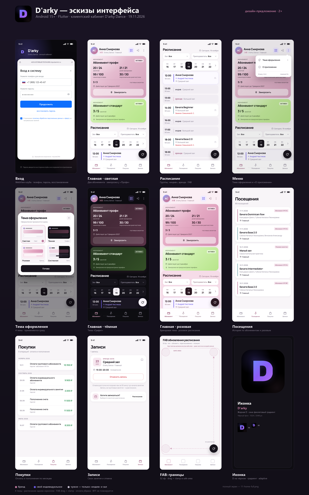

# Эскизы D'arky

Обновлённый комплект в **2× разрешении**: экраны 1560×3376, длинная главная 1560×6953, борд 3290×5268.
Откройте [board.png](board.png) — 12 плиток: экраны, темы, меню, FAB и иконка.



WebView больше не используется в auth (D15); всё о нём — в
[WEBVIEW-NOTES.md](WEBVIEW-NOTES.md). `01-auth.png` — нативный экран на AVD API 35.

## Экраны

| Файл | Экран |
|---|---|
| [01-auth.png](mockups/01-auth.png) | Вход, нативный (D15): телефон, пароль, восстановление в браузере |
| [02-home.png](mockups/02-home.png) | Главная: два абонемента, заморозка у «Профи», FAB |
| [03-schedule.png](mockups/03-schedule.png) | Расписание: фильтры, неделя, группа / «индив» / аренда |
| [07-theme-menu.png](mockups/07-theme-menu.png) | Меню `⋮` справа от выхода |
| [08-theme-dialog.png](mockups/08-theme-dialog.png) | Диалог четырёх тем |
| [09-home-dark.png](mockups/09-home-dark.png) | Главная, тёмная тема «Графит» |
| [10-home-pink.png](mockups/10-home-pink.png) | Главная, розовая тема, розовое расписание |
| [04-visits.png](mockups/04-visits.png) | Посещения |
| [05-purchases.png](mockups/05-purchases.png) | Покупки |
| [06-bookings.png](mockups/06-bookings.png) | Записи |
| [12-fab-spec.png](mockups/12-fab-spec.png) | Границы перетаскивания FAB |
| [11-home-full.png](mockups/11-home-full.png) | Главная целиком: два абонемента и расписание без вложенного скролла |

## Иконка

| Файл | Назначение |
|---|---|
| [icon/icon-2048.png](icon/icon-2048.png) | Основная иконка 2048×2048, чёрный фон, градиентная `D` |
| [icon/icon-1024.png](icon/icon-1024.png) | 1024×1024 |
| [icon/icon-512.png](icon/icon-512.png) · [192](icon/icon-192.png) · [96](icon/icon-96.png) · [48](icon/icon-48.png) | Производные размеры |
| [icon/icon-rounded-1024.png](icon/icon-rounded-1024.png) | Скруглённый вариант для превью |
| [icon/adaptive-foreground-432.png](icon/adaptive-foreground-432.png) | Foreground для Android adaptive icon, прозрачный фон |
| [icon/adaptive-background-432.png](icon/adaptive-background-432.png) | Background adaptive icon, `#000000` |
| [icon/monochrome-432.png](icon/monochrome-432.png) | Monochrome для themed icon |
| [icon/icon-preview.png](icon/icon-preview.png) | Размеры, adaptive, monochrome |

## Исходники

- [src/screens.html](src/screens.html) — все экраны, темы, меню, диалог;
- [src/screens.css](src/screens.css) — дизайн-токены, четыре темы, компоненты;
- [src/fab.html](src/fab.html) — схема границ FAB;
- [src/icons.html](src/icons.html) — иконка;
- [render.mjs](render.mjs) — рендер PNG через headless Chrome (scale 4);
- [compose.py](compose.py) — производные иконки, борд, карточка иконки.

Перерендер:

```powershell
node design/render.mjs
python design/compose.py
```

## Важно

- Это **эскизы, а не код приложения**. HTML/CSS нужен только для правок макета; после команды продолжать токены переносятся в Flutter-тему, экраны собираются нативно.
- Демо-профиль «Анна Смирнова» — вымышленный; данные тестового клиента и секреты в артефакты не переносились.
- Принятые решения: [DESIGN.md §10](DESIGN.md#10-принятые-решения-19112026). Там же — почему оплата убрана, а BFF не планируется.
